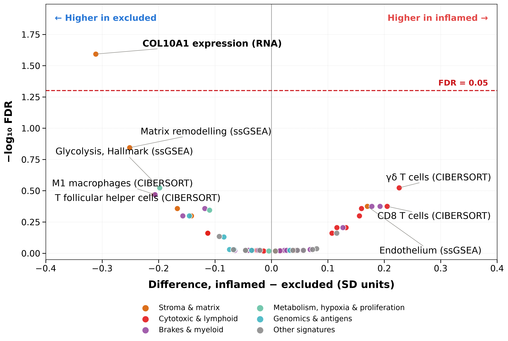
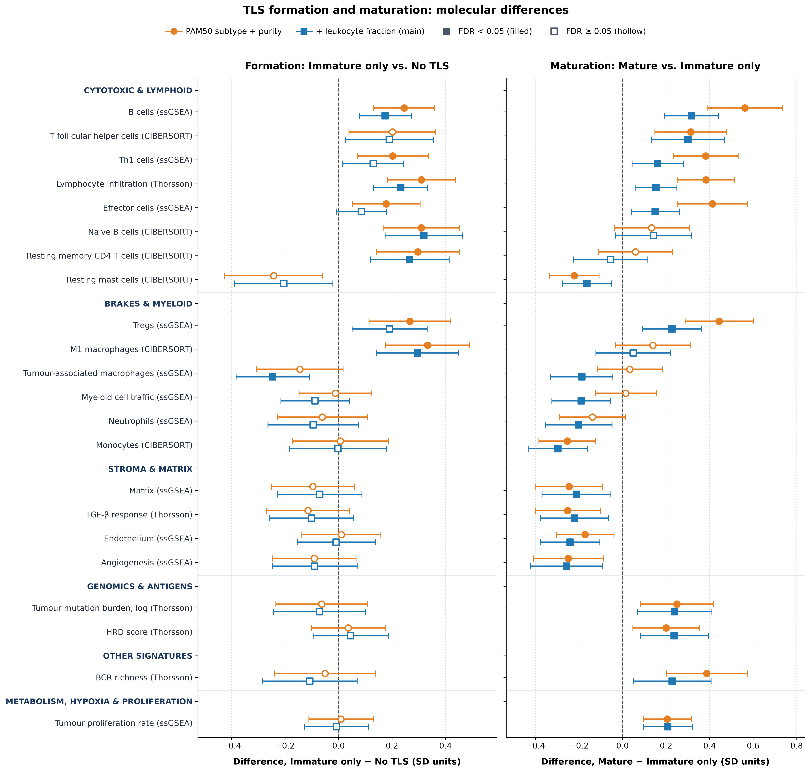
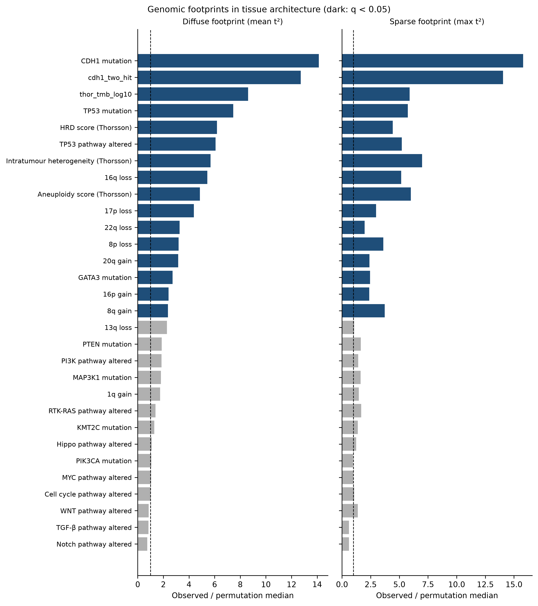
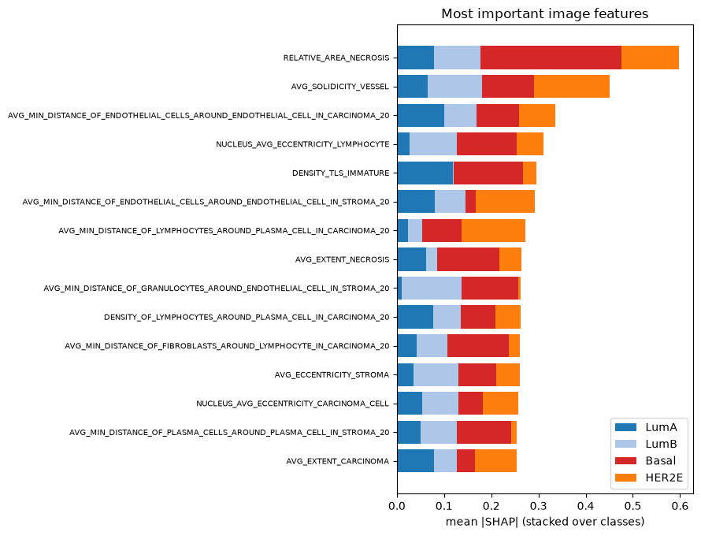

# OpenTME × TCGA: tumour microenvironment imaging features and multimodal cancer data

Capstone project of the [Data Science & AI Intensive Program](https://academy.constructor.org/data-science) at Constructor Nexademy, carried out in collaboration with [Aignostics](https://www.aignostics.com/).

[OpenTME](https://huggingface.co/datasets/Aignostics/OpenTME) provides interpretable tumour microenvironment (TME) features computed by Atlas H&E-TME on the diagnostic H&E slides of [The Cancer Genome Atlas (TCGA)](https://www.cancer.gov/tcga): cell densities and compositions, tissue areas, cell neighbourhoods, tumour zones and tertiary lymphoid structures (TLS). TCGA profiled the same patients at the molecular and clinical level. This project integrates both sources at the patient level and asks what the image and the molecular data reveal together. The pilot indication is **breast cancer (TCGA-BRCA)**; the pipeline is configured to run on other OpenTME cancer types.

## Questions

1. **Spatial immune phenotypes** (notebook 04): within immune-rich tumours, how does the location of lymphocytes (inflamed vs. excluded) relate to the molecular profile?
2. **Tertiary lymphoid structures** (notebook 05): what changes molecularly as TLS form and mature?
3. **Genomic footprints** (notebook 06): which genomic alterations leave a recognisable mark on tissue architecture, beyond molecular subtype?
4. **Subtype prediction** (notebook 07): can interpretable image features predict the molecular subtype, and which features does the model use?
5. **Genomic alteration prediction** (notebook 08, preliminary): can they predict TP53 mutation, mutational burden and aneuploidy?

## Main results (breast cancer)

- **Immune exclusion** is associated with a stromal barrier (CAF / TGF-β programme, COL10A1), and **TLS maturation** with germinal-centre biology (B cells, follicular helper T cells, BCR diversity), less stroma and fewer myeloid cells, and higher mutational burden.
- **CDH1 loss** (lobular carcinoma) leaves the strongest tissue footprint; most other footprints belong to a single genomic-instability axis (TP53, TMB, HRD, aneuploidy, arm-level events).
- **Subtype** is predicted with AUC ≈ 0.85 on held-out tissue source sites, mainly through necrosis (basal-like) and immune context (TLS and their maturation, plasma cells, infiltration pattern); luminal A and B are hard to separate without proliferation features.
- **Genomic alterations** (preliminary): the image alone performs like a clinical baseline, with some signal of its own within luminal tumours.

<table>
  <tr>
    <td colspan="2"><b>1. Inflamed vs. excluded tumours</b>: molecular differences between the two spatial phenotypes in immune-rich tumours (notebook 04).</td>
  </tr>
  <tr>
    <td colspan="2" align="center"></td>
  </tr>
  <tr>
    <td colspan="2"><b>2. TLS formation and maturation</b>: molecular differences between TLS classes (notebook 05).</td>
  </tr>
  <tr>
    <td colspan="2" align="center"></td>
  </tr>
  <tr>
    <td colspan="2"><b>3. Genomic footprints</b>: image-wide footprint of each genomic alteration over a permutation null (notebook 06).</td>
  </tr>
  <tr>
    <td colspan="2" align="center"></td>
  </tr>
  <tr>
    <td colspan="2"><b>4. Subtype prediction</b>: image features used by the model, by subtype (SHAP, notebook 07).</td>
  </tr>
  <tr>
    <td colspan="2" align="center"></td>
  </tr>
</table>

## Repository structure

```
├── configs/
│   ├── project.yaml          # paths, file names, OpenTME repository, density units
│   ├── analysis.yaml         # parameters of every notebook (one section per step)
│   ├── variable_labels.yaml  # readable names of the variables in figures
│   └── indications/
│       └── breast.yaml       # cancer-specific choices (subtypes, strata, hypotheses...)
├── notebooks/                # 01-08, run in order (see below)
├── src/opentme_tcga/         # reusable code imported by the notebooks
├── tests/                    # unit tests on synthetic data
├── results/<indication>/     # tables (CSV), one folder per notebook
├── figures/<indication>/     # figures (PNG), one folder per notebook
└── data/                     # raw and processed data (not in git, see below)
```

## Notebooks

| Notebook | Description | Main outputs |
|---|---|---|
| `01_opentme_processing` | Loads the five OpenTME tables, merges them per slide, slide QC, one slide per patient, feature selection and derived features | OpenTME master table (patients × image features) |
| `02_tcga_molecular_data` | Builds the molecular and clinical table: clinical data, subtypes, purity, immune landscape, mutations, pathways, arm-level events, hypoxia, RNA signatures; validation and redundancy | TCGA molecular table and data dictionary |
| `03_integration` | Joins image and molecular tables at the patient level | Integrated table and provenance of every column |
| `04_immune_phenotypes` | Hot / cold tumours, infiltration index (tumour core vs. invasive margin), inflamed vs. excluded; hypotheses, subtype consistency, unbiased screen, outcome | Phenotype table (input of 05), forest and volcano plots |
| `05_tls_analysis` | TLS classes (none / immature only / mature), RNA validation, molecular changes with TLS formation and maturation | Volcano, forest and subtype heatmap |
| `06_genomic_footprints` | Every genomic variable against every image feature, permutation test within subtype, increasing adjustment, CDH1 positive control | Image-wide footprint per alteration |
| `07_subtype_prediction` | Site-held-out evaluation, four model families, model selection, SHAP, final test | Selected model, SHAP figures, test performance |
| `08_genomic_alteration_prediction` | Preliminary: TP53, TMB and aneuploidy from the image vs. a clinical baseline, within subtypes, SHAP, final test | Cross-validation and test performance |

Each notebook starts with its aim and structure, and ends sections with short *Observations* on the breast cancer results.

## Installation

Requires Python 3.12 and [uv](https://docs.astral.sh/uv/).

```bash
git clone https://github.com/red-moonx/opentme-tcga-integration.git
cd opentme-tcga-integration
uv sync                     # creates .venv with all dependencies
uv run pytest -q            # optional: unit tests (synthetic data, a few seconds)
```

Open the notebooks with Jupyter (`uv run jupyter lab`) or an editor that uses the `.venv` kernel.

## Data

No data is stored in this repository. Everything is downloaded into `data/`, which is git-ignored:

```
data/
├── raw/
│   ├── opentme/      # OpenTME download (all cancer types)
│   └── tcga/         # TCGA PanCanAtlas sources (shared by all cancer types)
├── interim/          # created by notebooks 01-02
└── processed/        # created by notebooks 01-04, one file per cancer type
```

To keep the data elsewhere, set `OPENTME_TCGA_DATA_DIR=/path/to/data` in a `.env` file at the repository root.

### OpenTME

OpenTME is a gated dataset on Hugging Face for academic, non-commercial use. Request access on its [dataset page](https://huggingface.co/datasets/Aignostics/OpenTME), then log in once in a terminal:

```bash
uv run hf auth login
```

The token is stored by Hugging Face on your computer; never write it in code, configuration files or notebooks. Notebook 01 downloads the tables the first time (set `DOWNLOAD = True` in its section 1). The analysis uses a fixed version of OpenTME (`opentme.revision` in `configs/project.yaml`), so the same data are downloaded every time; later releases add more tables and have not been tested with this code. Notebook 04 downloads only the two slide images it shows.

### TCGA

Notebook 02 downloads the *automatic* files the first time it runs. The *by hand* files are supplementary tables of the publications: download them and save them in `data/raw/tcga/` with the given name. If a file is missing, the notebook stops and says which one.

| Data | Source | Download | File in `data/raw/tcga/` |
|---|---|---|---|
| Clinical | [TCGA-CDR](https://gdc.cancer.gov/about-data/publications/PanCan-Clinical-2018) (Liu et al. 2018) | automatic | `TCGA-CDR-SupplementalTableS1.xlsx` |
| Purity and ploidy | [ABSOLUTE, PanCanAtlas](https://gdc.cancer.gov/about-data/publications/pancanatlas) (Taylor et al. 2018) | automatic | `TCGA_mastercalls.abs_tables_JSedit.fixed.txt` |
| Somatic mutations | [MC3](https://gdc.cancer.gov/about-data/publications/mc3-2017) (Ellrott et al. 2018) | automatic | `mc3.v0.2.8.PUBLIC.maf.gz` |
| Arm-level copy number | Taylor et al. 2018, via [cBioPortal](https://github.com/cBioPortal/datahub/tree/master/public) | automatic | `cbioportal_<code>_data_armlevel_cna.txt` |
| Hypoxia scores | Bhandari et al. 2019, via [cBioPortal](https://github.com/cBioPortal/datahub/tree/master/public) | automatic | `cbioportal_<code>_data_clinical_supp_hypoxia.txt` |
| Immune landscape, CIBERSORT | [Thorsson et al. 2018](https://doi.org/10.1016/j.immuni.2018.03.023), Table S1 | by hand | `thorsson_2018_table_s1.xlsx` |
| Driver genes | [Bailey et al. 2018](https://doi.org/10.1016/j.cell.2018.02.060), Table S1 | by hand | `bailey_2018_table_s1.xlsx` |
| Oncogenic pathways | [Sanchez-Vega et al. 2018](https://doi.org/10.1016/j.cell.2018.03.035), Table S4 | by hand | `sanchez_vega_2018_pathways.xlsx` |
| TME signatures | [Bagaev et al. 2021](https://doi.org/10.1016/j.ccell.2021.04.014), Table S1 | by hand | `bagaev_2021_table_s1.xlsx` |
| RNA-seq | [UCSC Xena](https://xenabrowser.net/datapages/), TCGA HiSeqV2 | by hand | `TCGA.<CODE>.HiSeqV2.gz` |
| Breast subtypes (PAM50, TNBC) | [Thennavan et al. 2021](https://pmc.ncbi.nlm.nih.gov/articles/PMC9028992/), Data S1 | by hand | `Thennavan_2021_DataS1.xlsx` |

`<code>` / `<CODE>` is the TCGA code of the indication (breast: `brca` / `BRCA`). Notebook 02 also needs internet access the first time, to fetch the MSigDB gene sets used for some signatures.

## Running the pipeline

Run the notebooks in order, **01 → 08**, each with a fresh kernel: every notebook reads what the previous ones saved. Notebooks 06-08 take longest (permutation tests and model searches). Tables are written to `results/<indication>/<notebook>/` and figures to `figures/<indication>/<notebook>/`.

## Configuration

All parameters live in YAML files, merged in this order by `opentme_tcga.config.load_config`:

1. `configs/project.yaml`: paths, file names, OpenTME repository and density units.
2. `configs/analysis.yaml`: one section per step (`opentme_processing`, `tcga_molecular`, `integration`, `immune_phenotypes`, `tls_analysis`, `genomic_footprints`, `genomic_prediction` for notebook 07, `genomic_alterations` for notebook 08).
3. `configs/indications/<name>.yaml`: cancer-specific choices, which may override any value of 1 and 2.

### Adding another cancer type

1. Copy `configs/indications/breast.yaml` to, for example, `lung.yaml`, and set the `indication` block (OpenTME name, TCGA project and code, cBioPortal study).
2. Review the cancer-specific choices. Without them, defaults apply: the TCGA subtype of Thorsson et al. 2018 instead of PAM50, no extra strata, no positive control.
3. Set `INDICATION = "lung"` in the setup cell of each notebook and run them in order. Results go to `results/lung/` and `figures/lung/`; processed files are named after the cancer type, so indications never overwrite each other.

## Data use and citation

OpenTME is used for academic research under its terms of use; its data are not redistributed here. Any use of this work must cite OpenTME:

> Galama M. et al. *OpenTME: An Open Dataset of AI-Powered H&E Tumor Microenvironment Profiles from TCGA.* arXiv:2604.12075, 2026.

TCGA data come from the PanCanAtlas publications listed in the data table above, which should be cited for the corresponding layers.

## License

The code is released under the [MIT License](LICENSE). The license covers the code only: OpenTME and TCGA data remain under their own terms of use.

## Next steps

- An interactive app (e.g. Streamlit) to explore the results and run the pipeline on other cancer types.
- Running the pipeline on a second OpenTME cancer type with real data.
- For the open questions and limitations of each analysis, see the *Observations* in the notebooks.

## Author

Luna Zea Redondo — capstone project, Data Science & AI program (Constructor Nexademy), in collaboration with Aignostics.
